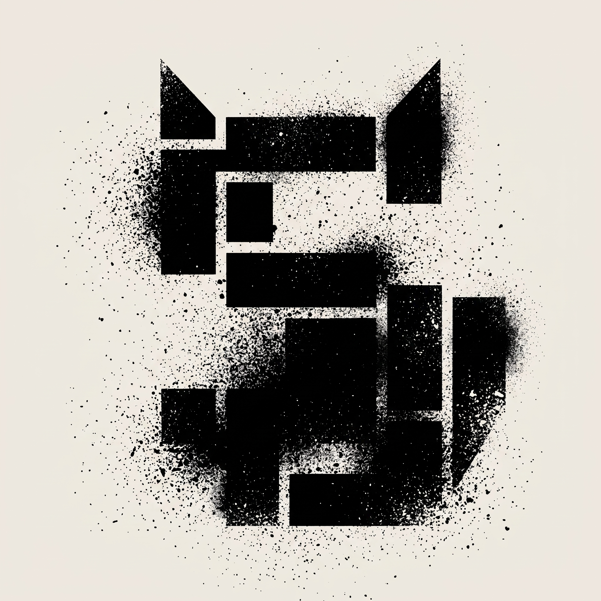

<p align="center">
  
</p>

# SupraOS

A minimal Alpine Linux desktop mod, inspired by [Omarchy](https://github.com/basecamp/omarchy)
but stripped down to the bone for weak hardware. Built on (and for) a Dell
Chromebook 12 with a 2-core Celeron and 4 GB of RAM.

One script, one tarball, one monochrome theme.

## Philosophy

- **Everything the setup needs lives in one POSIX sh script.** Packages, services,
  groups, and every dotfile are restored by running a single file.
- **Nothing you don't need.** No systemd (OpenRC), no display manager (sway from
  tty1 via `.profile`), no themes, no bling. If it isn't used daily, it isn't installed.
- **One look.** Black `#000000`, warm off-white `#e8e6df`, 2px square borders,
  zero gaps, DejaVu Sans Mono everywhere.

## The stack

| Role          | Tool      |
|---------------|-----------|
| Compositor    | Sway      |
| Bar           | Waybar    |
| Terminal      | foot      |
| Launcher      | fuzzel    |
| File manager  | pcmanfm   |
| Browser       | Firefox   |
| Screenshots   | grim + slurp + wl-copy |
| Audio         | PipeWire + WirePlumber |
| Brightness    | brightnessctl |
| Lock / idle   | gtklock (patched) + swayidle |
| Services      | OpenRC + seatd + elogind + dbus |

## Install

On a fresh Alpine Linux install (run `setup-alpine` first, create a normal user,
make sure you know the root password):

```sh
wget -O supra-bootstrap.sh https://raw.githubusercontent.com/drive85/SupraOS/main/supra-bootstrap.sh
chmod +x supra-bootstrap.sh
./supra-bootstrap.sh
```

Then reboot (or log out and back in) and sway starts on tty1.

What the script does:

1. Asks two questions: install Firefox? [Y/n] — install OpenCode? [y/N]
2. Enables the community repository, installs all packages (as root via `su`)
3. Enables the OpenRC services (udev, seatd, dbus, wpa_supplicant, ...)
4. Adds your user to the seat/video/input/audio groups
5. Extracts every config file into your home directory

Wi-Fi: click the network icon in the bar. A popup opens under it with the live
list — connected network first, then strongest to weakest, 8 rows tall and
scrollable after that. Click or Enter a network to connect (inline password
when it's a new locked one); click the connected network for its ip, frequency
and signal, with a disconnect button. Click anywhere outside or press Esc to
close. Underlying config lives in `wpa_supplicant` (edit
`/etc/wpa_supplicant/wpa_supplicant.conf` as root). Timezone/hostname/keymap
come from your `setup-alpine` answers.

Lockscreen: Super+L, closing the lid, 10 minutes idle or before sleep. Pure
black with a clock and date; a single thin box appears once you start typing
(dots for each character). Hold the eye icon to see the password, let go and
it hides again. It is gtklock, patched for hold-to-reveal — sources and build
steps in `dev/lock-app/`. The power button opens the power menu instead of
cutting power.

## Keybinds

| Keys              | Action                          |
|-------------------|---------------------------------|
| Super+Return      | terminal (foot)                 |
| Super+Space       | launcher (fuzzel)               |
| Super+B           | Firefox                         |
| Super+E           | pcmanfm                         |
| Super+W           | close window                    |
| Super+F           | fullscreen                      |
| Super+Arrows/HJ K; | focus (right is ; since L locks) |
| Super+Shift+Arrows| move window                     |
| Super+1..9        | workspaces                      |
| Super+Shift+1..9  | send window to workspace        |
| Super+V           | split vertically                |
| Alt+Tab           | cycle focus                     |
| Super+S           | screenshot region (copies it)   |
| Super+Shift+S     | screenshot full screen          |
| XF86 brightness   | brightness up/down              |
| XF86 volume       | volume up/down/mute (shown in bar) |
| Super+L           | lock screen (lockscreen)      |
| Power button      | power menu (lock/suspend/…)   |

## The Supra menus

Fuzzel also lists these desktop entries (they are plain shell one-liners,
great templates to steal from):

- **Trigger** — screenshot region/fullscreen, keybinding cheat-sheet
- **Setup** — audio mixer, edit sway/waybar/fuzzel config
- **Power** — lock, suspend, logout, reboot, shutdown (also the power button)
- **Update** — `apk upgrade` everything
- **About** — system info summary

## Repo layout

- `supra-bootstrap.sh` — the whole OS restore: package list + services + embedded
  base64 tarball of every config
- `dev/` — dev environment (skill, build-backups, one-shot setup), plus `wifi-app/` (wifi popup) and `lock-app/` (patched gtklock lockscreen, vendored upstream sources)
- `NOTES.md` — working notes: audit results, decisions, pending ideas
- `AGENTS.md` — instructions for AI assistants working on this repo

## Dev environment (opencode)

Work on SupraOS from any PC, one shot:

```sh
git clone https://github.com/drive85/SupraOS.git && cd SupraOS
./dev/setup-dev.sh   # links the opencode skill + backups into live paths
```

Live paths are symlinks into the clone, so new backups and skill edits land in
the repo and travel with the next push. Details in `dev/README.md`.

## Roadmap

Updated dynamically as work lands.

| Feature | Progress |
|---------|----------|
| Bootstrap/restore — one script, whole OS | 100% |
| Top bar — battery, calendar, FA7 icons, wifi module | 100% |
| Wifi popup — click bars, gtk-layer-shell app: live list, 8 rows, inline PSK, info view, click-outside/ESC | 100% |
| Audio — pipewire/wireplumber, working volume keys and sound | 100% |
| Lock screen — gtklock: black, box on typing, dots, hold-to-reveal eye; Super+L, lid, idle | 100% |
| Power menu — power button opens lock/suspend/logout/reboot/shutdown | 100% |
| Setup menu — working entries only (dead Wi-Fi entry removed) | 100% |
| keyd — Chromebook top-row remap (brightness/volume/media) | 100% |

## Known quirks

Honest list (kept in `NOTES.md` with full detail):

- No volume/brightness OSD overlay: feedback is live in the bar (volume and
  backlight modules). SwayOSD was rejected as a Rust/GTK4 daemon on this
  hardware.
- The wifi popup opens on click only: waybar custom modules have no hover
  event. The click that dismisses it is swallowed, like any popup menu.
- The bootstrap restores configs and packages, but not personal data: Firefox
  profile, Wi-Fi passwords, and (optionally-installed) OpenCode binary are yours
  to bring back.

## License

Do whatever you want. It's dotfiles and a shell script.
